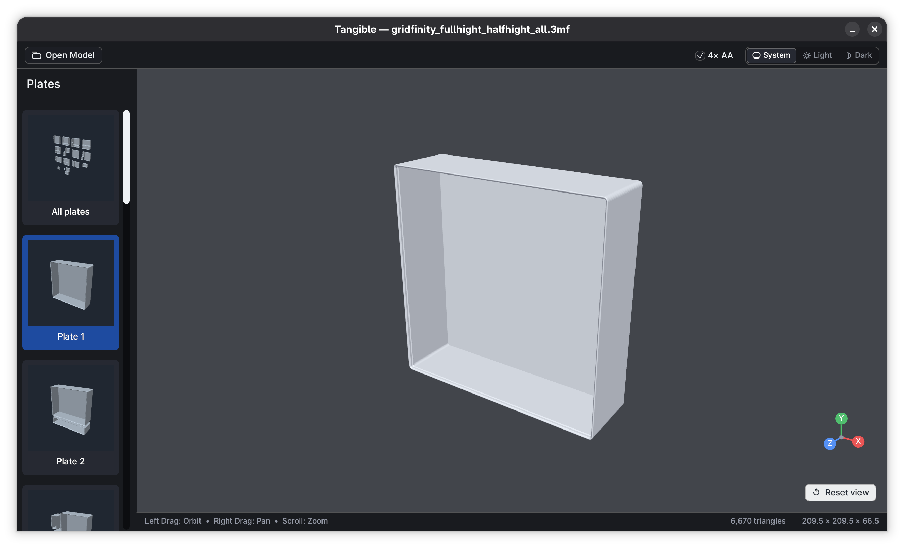

# Tangible

A simple, cross-platform STL, OBJ, and 3MF file viewer written in Rust.



## Features

- **Cross-platform** — runs natively on Windows, macOS, and Linux
- **GUI File Opening** — native file dialog (`rfd`), top bar button, and drag-and-drop
- **GPU-accelerated** — uses `wgpu` (Vulkan / Metal / DX12)
- **STL, OBJ & 3MF** — binary and ASCII STL, polygonal OBJ, and zipped 3MF models
- **Antialiasing** — 4× MSAA enabled by default on supported GPUs
- **3MF plate selection** — shaded square previews for all plates and each individual plate, with a resizable and collapsible panel
- **Model details** — displays filename, triangle/vertex counts, and bounding box dimensions

## Usage

You can launch the viewer with or without a file:

```bash
# Launch GUI directly (open files via button, dialog, or drag-and-drop)
cargo run --release

# Or launch with a file directly
cargo run --release -- path/to/model.obj
```

## Building

```bash
# Debug build
cargo build

# Release build (recommended)
cargo build --release
```

### Platform Requirements

- **Linux**: Vulkan-capable GPU + drivers (`mesa-vulkan-drivers` or proprietary)
- **macOS**: Metal-capable GPU (any Mac from 2012+)
- **Windows**: DX12 or Vulkan-capable GPU

## Releases

Each push to `main` builds native applications for Linux x86-64, macOS Apple
silicon, and Windows x86-64 and publishes them on the repository's Releases
page. Download and extract the archive for your platform to run the application.
