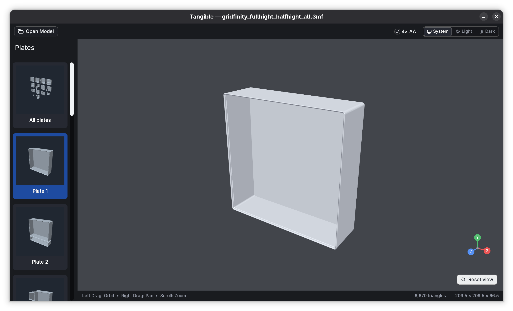

# Tangible

A simple, cross-platform 3D file viewer written in Rust.



## Features

- **STL, OBJ, 3MF, OFF, PLY, glTF & GLB support**
- **Cross-platform** — runs natively on Windows, macOS, and Linux
- **GPU-accelerated** — uses `wgpu` (Vulkan / Metal / DX12)
- **3MF plate selection** — previews for each plate, with a resizable and collapsible panel
- **Model details** — displays filename, triangle/vertex counts, and bounding box dimensions
- **glTF playback controls** — pause and resume the first glTF animation with the Pause checkbox
- **Saved preferences** — theme, projection, and window size are restored after closing normally
- **Perspective/Orthographic projection**
- **Light/dark mode**

## Usage

### From releases

Simply go to the [releases page](https://github.com/peter-lamantia/tangible/releases/latest), and download and run the corresponding package!

### From source

Requires rust installation. Linux source builds also require the Wayland, xkbcommon, and GTK 3 development
packages (on Debian/Ubuntu: `libwayland-dev libxkbcommon-dev libgtk-3-dev`).

```bash
# Launch GUI directly (open files via button, dialog, or drag-and-drop)
cargo run --release

# Or launch with a file directly
cargo run --release -- path/to/model.obj
```

## Requirements

- **Linux**: Vulkan-capable GPU + drivers (`mesa-vulkan-drivers` or proprietary)
- **macOS**: Metal-capable GPU (any Mac from 2012+)
- **Windows**: DX12 or Vulkan-capable GPU

## Configuration

Preferences are saved on normal window close in `tangible/preferences` beneath
`%APPDATA%` on Windows, `~/Library/Application Support` on macOS, and
`$XDG_CONFIG_HOME` (or `~/.config`) on Linux.
